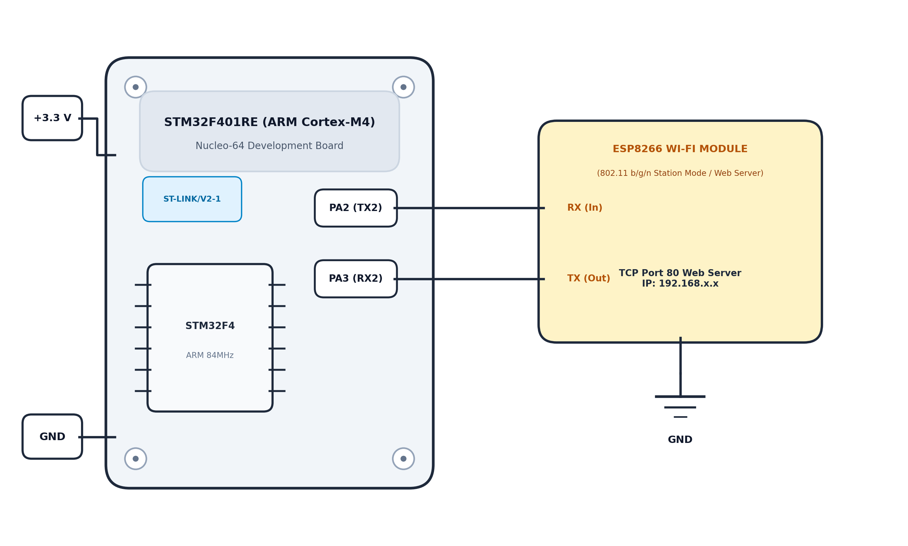

# CAT10 - STM32 and ESP8266

## STM32-ESP8266 Modem & Embedded Web Server

**STUDENT REGISTER NO:** 25011102040  

---

### Overview
This folder contains the STM32-ESP8266 UART, AT-command, and embedded HTTP-server tasks. The task READMEs are the authoritative documentation for each implementation.

### Circuit Schematic

## Build steps

1. Open the task-specific CubeMX/Keil project.
2. Build the firmware with the configured toolchain.
3. Connect the ST-Link programmer.
4. Flash the generated image.
5. Reset the board and verify the task-specific UART or HTTP behavior.

## Subtasks

- [TASK10A](TASK10A/README.md) - STM32-ESP8266 UART bridge and AT-command bring-up.
- [TASK10B](TASK10B/README.md) - ESP8266 AT-command state machine.
- [TASK10C](TASK10C/README.md) - Embedded HTTP web server.

