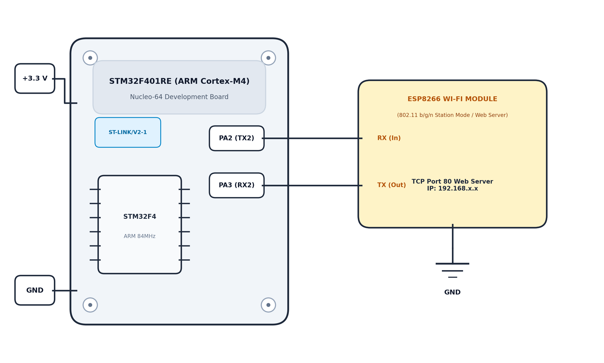

# CAT10A - STM32 to ESP8266 UART Communication

**EXP:** CONTINUOUS ASSESSMENT 10

**TASK:** TASK10A

**STUDENT REGISTER NO:** 25011102040

**COURSE:** Foundations of IoT (FIoT)

**NAME OF EXP:** Establish STM32 to ESP8266 UART Communication

**HARDWARE SETUP / PLATFORM:** Embedded Development Kit + Keil / STM32CubeIDE

---

## 1. Objective
To interface STM32 with an Espressif ESP8266 (Wemos D1 Mini / ESP-01) module via USART and establish bidirectional communication.

---

## 2. Hardware Connections & Pin Mapping

| Microcontroller Pin | Peripheral Line | Description |
|:---:|:---:|:---|
| **PA2 (USART2_TX)** | ESP8266 RX | Serial AT command interface |
| **PA3 (USART2_RX)** | ESP8266 TX | Serial AT response interface |
| **PA9 (USART1_TX)** | PC/debug RX | Serial bridge output |
| **PA10 (USART1_RX)** | PC/debug TX | Serial bridge input |

---

## 3. Circuit Schematic Diagram

---

## 4. Working principle

The firmware sends `AT`, `AT+CWMODE=1`, `AT+CWJAP`, and `AT+CIFSR` through USART2 to the ESP8266, then bridges characters between USART2 and the PC/debug USART1. The source currently contains Wi-Fi credentials in the application code; replace them locally before sharing or deploying the firmware.

---

## 5. Build, Flash & Verification Steps
1. Open the Keil project file (`*.uvproj` or `MDK-ARM/*.uvprojx`).
2. Build the target firmware (Press `F7`).
3. Connect the hardware debugger (USBasp for 8051 or ST-Link V2 for STM32).
4. Download the compiled binary (`F8`).
5. Open serial terminal or inspect visual indicators to verify task execution.

## Source files

- [`Core/Src/main.c`](Core/Src/main.c) - UART bridge and ESP8266 AT-command sequence.
- [`Core/Inc/main.h`](Core/Inc/main.h) - Application declarations.
- [`lab10.ioc`](lab10.ioc) - STM32CubeMX configuration.
- [`MDK-ARM/lab10.uvprojx`](MDK-ARM/lab10.uvprojx) - Keil project.
- [`circuit.png`](circuit.png) - Circuit diagram.

