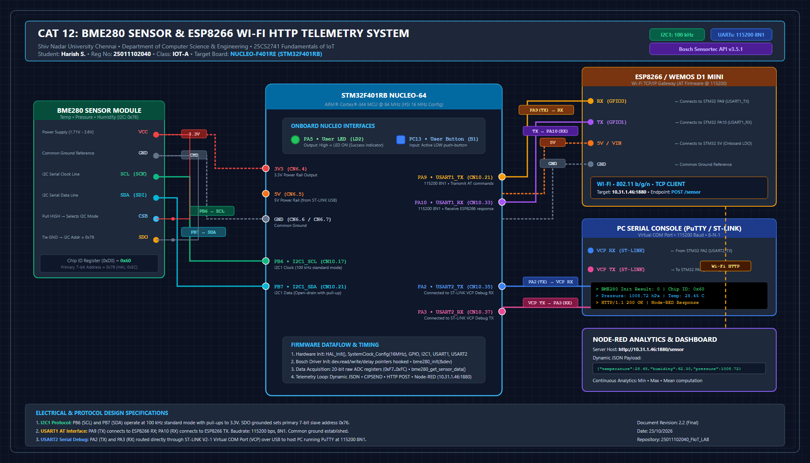

# EXPERIMENT DETAILS

| Field | Description |
|---|---|
| **EXP** | CONTINUOUS LAB EVALUATION-12 (CAT 12) |
| **DATE** | 23/10/2026 |
| **NAME OF EXP** | BME280 Sensor Interfacing Using I2C and Bosch Sensor API |
| **HARDWARE SETUP / PLATFORM** | CubeMX + Keil MDK + STM32 Nucleo Development Board (STM32F401RB) + BME280 + ESP8266 |
| **TASK NO** | CAT 12 (Task 12A, Task 12B, Task 12C) |
| **Circuit Diagram** | Hardware connection schematic embedded below |
| **Core Logic / Pseudocode / Code Base** | Bosch Sensor API v3.5.1 + HAL I2C1 + Dual UARTs + ESP8266 HTTP POST |
| **INFERENCE** | Successfully acquired environmental parameters, compensated via Bosch algorithms, and pushed dynamic JSON telemetry to Node-RED |

---

## 1. Objective

To design, develop, and implement an industrial-grade environmental monitoring embedded IoT node using an **STM32F401RB Nucleo-64** microcontroller. The system interfaces a **Bosch Sensortec BME280** digital sensor over the **I2C protocol** using the official **Bosch Sensortec Sensor API**, retrieves factory trimming parameters, acquires 20-bit raw ADC registers for temperature, barometric pressure, and relative humidity, applies polynomial compensation algorithms, formats the readings into a dynamic JSON string, and pushes real-time telemetry over Wi-Fi via an **ESP8266** module using HTTP POST requests to a **Node-RED** analytics server.

---

## 2. Problem Statement

In modern IoT and smart building systems, precision environmental monitoring requires accurate acquisition of ambient temperature, atmospheric pressure, and relative humidity. Low-cost sensors often exhibit factory process variations, non-linear sensor curve characteristics, and susceptibility to supply variations. 

To overcome these issues:
1. The firmware must interface the BME280 over I2C at 100 kHz standard mode, verify the hardware Chip ID (`0x60`), and load factory trimming parameters (`dig_T1..T3`, `dig_P1..P9`, `dig_H1..H6`).
2. The firmware must configure oversampling and IIR filters to suppress environmental noise.
3. Raw 20-bit measurement registers (`0xF7` through `0xFC`) must be acquired and evaluated using Bosch mathematical compensation equations.
4. Compensated data must be streamed over UART to a PC debug terminal while concurrently bridged via a second UART to an ESP8266 Wi-Fi module using AT commands to maintain a persistent TCP socket and push dynamic JSON HTTP requests to an analytics dashboard.

---

## 3. Hardware Components

1. **STM32F401RB Nucleo-64 Board**:
   - 32-bit ARM® Cortex®-M4 MCU with FPU, 84 MHz maximum frequency, 512 KB Flash, 96 KB SRAM.
   - Onboard ST-LINK/V2-1 debugger with USB Virtual COM Port (VCP).
2. **Bosch Sensortec BME280 Sensor Breakout**:
   - Combined digital temperature (-40 to +85 °C), pressure (300 to 1100 hPa), and humidity (0 to 100 %RH) sensor.
   - 7-bit I2C address: `0x76` (SDO pulled to GND) or `0x77` (SDO pulled to 3.3V).
3. **ESP8266 Wi-Fi Module (Wemos D1 Mini / ESP-01)**:
   - 802.11 b/g/n Wi-Fi SoC flashed with Espressif standard AT command firmware (v1.7+), operating at 115200 baud.
4. **Host PC**:
   - Running serial terminal software (PuTTY) connected via USB to Nucleo Virtual COM Port for live debugging.
5. **Node-RED Server**:
   - Local network IoT platform listening on IP `10.31.1.46`, Port `1880`, receiving HTTP POST requests at `/sensor`.
6. **Connecting Jumper Wires & Breadboard**.

---

## 4. Software Requirements

- **STM32CubeMX**: Version 6.18.0 for graphical pinout allocation, clock tree setup, and HAL initialization.
- **Keil MDK-ARM (uVision)**: Version 5.32+ with ARM Compiler 6 (armclang) toolchain.
- **STM32F4xx HAL Driver & CMSIS**: Embedded C hardware abstraction layer.
- **Bosch Sensortec BME280 Sensor API**: Official driver release v3.5.1 (`bme280.c`, `bme280.h`, `bme280_defs.h`).
- **Serial Debugger**: PuTTY (115200 baud, 8 data bits, no parity, 1 stop bit).
- **Node-RED**: Flow runtime with HTTP In, JSON parser, and Dashboard gauges/charts.

---

## 5. Hardware Architecture

```text
+---------------------+           +------------------------+           +-----------------------+
|    BME280 Sensor    |           |  STM32F401RB Nucleo    |           |  ESP8266 Wemos Module |
|                     |           |                        |           |                       |
| VCC <---------------+-- 3.3V -- | 3V3 (CN6.4)   5V/VIN --+-- 5V ---> | 5V / VIN              |
| GND <---------------+-- GND --- | GND (CN6.6)      GND --+-- GND --> | GND                   |
| CSB <---------------+-- 3.3V -- | (Selects I2C Mode)     |           |                       |
| SDO <---------------+-- GND --- | (Sets Addr = 0x76)     |           |                       |
| SCL <-------------------------- | PB6 (I2C1_SCL)         |           |                       |
| SDA <-------------------------> | PB7 (I2C1_SDA)         |           |                       |
|                     |           |                        |           |                       |
|                     |           | PA9 (USART1_TX) -------+---------> | RX (GPIO3)            |
|                     |           | PA10 (USART1_RX) <-----+---------- | TX (GPIO1)            |
|                     |           |                        |           +-----------+-----------+
|                     |           | PA2 (USART2_TX) -------+--------+              |
|                     |           | PA3 (USART2_RX) <------+----+   |              | Wi-Fi 802.11 b/g/n
|                     |           |                        |    |   |              | TCP Port 1880
|                     |           | PA5 (User LED LD2)     |    |   |              v
|                     |           | PC13 (User Button B1)  |    |   |  +-----------------------+
+---------------------+           +------------------------+    |   |  | Node-RED Server       |
                                                                |   |  | (10.31.1.46:1880)     |
                                                                v   v  +-----------------------+
                                                          +----------------+
                                                          | PC Host PuTTY  |
                                                          | 115200 8-N-1   |
                                                          +----------------+
```

---

## 6. Pin Configuration Table

| Microcontroller Pin | Peripheral Mode | Alternate Function | Connected External Component | Electrical Signal Description |
|---|---|---|---|---|
| **PB6** | I2C1_SCL | AF4 | BME280 SCL (SCK) | I2C Serial Clock (100 kHz Standard Mode) |
| **PB7** | I2C1_SDA | AF4 | BME280 SDA (SDI) | I2C Serial Data (Bidirectional Open-Drain) |
| **PA9** | USART1_TX | AF7 | ESP8266 RX (GPIO3) | Asynchronous Serial Transmit (AT Commands) |
| **PA10** | USART1_RX | AF7 | ESP8266 TX (GPIO1) | Asynchronous Serial Receive (AT Responses) |
| **PA2** | USART2_TX | AF7 | ST-LINK VCP RX | Virtual COM Port Transmit to PC Debug Terminal |
| **PA3** | USART2_RX | AF7 | ST-LINK VCP TX | Virtual COM Port Receive from PC Debug Terminal |
| **PA5** | GPIO_Output | None | Onboard User LED (LD2) | Push-Pull Output (Status & Telemetry Heartbeat) |
| **PC13** | GPIO_Input | None | Onboard Push Button (B1) | Digital Input with internal pull-up |
| **3V3 (CN6.4)** | Power Out | None | BME280 VCC & CSB | Regulated 3.3V power supply rail |
| **5V (CN6.5)** | Power Out | None | ESP8266 5V / VIN | 5V supply rail from ST-LINK USB to ESP8266 LDO |
| **GND (CN6.6)** | Ground | None | BME280 GND, SDO, ESP GND | Common reference ground across all subsystems |

---

## 7. Circuit Diagram



---

## 8. Working Principle

The system operates in a deterministic cyclic sequence:

1. **Power-On Reset & Clocks**:
   - The STM32 executes startup code from Flash, sets NVIC priority grouping to 4, configures the internal 16 MHz HSI clock, and initializes SysTick timer ticks.
   - GPIO ports A, B, and C clocks are enabled.

2. **Peripherals Bring-Up**:
   - `MX_I2C1_Init()` configures I2C1 at 100 kHz with 7-bit addressing.
   - `MX_USART1_UART_Init()` configures USART1 at 115200 baud (8N1) for the ESP8266 AT bridge.
   - `MX_USART2_UART_Init()` configures USART2 at 115200 baud (8N1) for PuTTY serial debugging.

3. **Bosch Sensor API Hooking**:
   - The `struct bme280_dev dev` instance is initialized by assigning custom function pointers:
     - `dev.read = user_i2c_read;`
     - `dev.write = user_i2c_write;`
     - `dev.delay_us = user_delay_us;`
     - `dev.intf = BME280_I2C_INTF;`
     - `dev.intf_ptr = &dev_addr;` (points to `0x76`).

4. **Sensor Initialization & Calibration Trim Readout**:
   - `bme280_init(&dev)` issues an I2C read to register `0xD0` to verify the chip ID equals `0x60`.
   - The driver automatically reads non-volatile factory calibration registers (`0x88..0xA1` and `0xE1..0xF0`) and populates `dev.calib_data` with parameters `dig_T1..T3`, `dig_P1..P9`, and `dig_H1..H6`.

5. **Measurement Configuration**:
   - Oversampling is set to 1X for temperature, pressure, and humidity:
     `dev.settings.osr_h = BME280_OVERSAMPLING_1X;`
     `dev.settings.osr_p = BME280_OVERSAMPLING_1X;`
     `dev.settings.osr_t = BME280_OVERSAMPLING_1X;`
     `dev.settings.filter = BME280_FILTER_COEFF_OFF;`
   - Settings are committed to hardware registers `0xF2` (`ctrl_hum`) and `0xF4` (`ctrl_meas`) via `bme280_set_sensor_settings()`.
   - Power mode is set to normal (`BME280_POWERMODE_NORMAL`) via `bme280_set_sensor_mode()`.

6. **Acquisition & Polynomial Compensation**:
   - Every 2 seconds, `bme280_get_sensor_data(BME280_ALL, &comp_data, &dev)` triggers.
   - Raw 20-bit pressure and temperature registers (`0xF7` through `0xFC`) are captured.
   - Bosch compensation algorithms compute fine temperature resolution `t_fine` to mathematically compensate non-linear pressure and humidity readings.

7. **Dynamic Telemetry & Cloud Push**:
   - Custom routine `FormatFloat2` formats floats to two decimal places.
   - Dynamic JSON payload is created:
     `{"status":"success","temperature":28.45,"humidity":62.30,"pressure":1008.72}`
   - HTTP Content-Length is dynamically calculated using `strlen(json)`.
   - An HTTP POST request is sent to `http://10.31.1.46:1880/sensor` over ESP8266 TCP using `AT+CIPSEND`.
   - The server response (`HTTP/1.1 200 OK`) is parsed and printed to the PuTTY console.

---

## 9. BME280 and Bosch Sensor API Integration

The Bosch Sensortec API decouples high-level mathematical sensor compensation from hardware-specific bus operations.

### Hardware Abstraction Layer Callbacks

```c
/* I2C Read Callback */
int8_t user_i2c_read(uint8_t reg_addr, uint8_t *reg_data, uint32_t len, void *intf_ptr)
{
    uint8_t dev_addr = *(uint8_t *)intf_ptr;
    if (HAL_I2C_Mem_Read(&hi2c1, (uint16_t)(dev_addr << 1), reg_addr,
                         I2C_MEMADD_SIZE_8BIT, reg_data, (uint16_t)len, HAL_MAX_DELAY) == HAL_OK)
    {
        return BME280_OK;
    }
    return BME280_E_COMM_FAIL;
}

/* I2C Write Callback */
int8_t user_i2c_write(uint8_t reg_addr, const uint8_t *reg_data, uint32_t len, void *intf_ptr)
{
    uint8_t dev_addr = *(uint8_t *)intf_ptr;
    if (HAL_I2C_Mem_Write(&hi2c1, (uint16_t)(dev_addr << 1), reg_addr,
                          I2C_MEMADD_SIZE_8BIT, (uint8_t *)reg_data, (uint16_t)len, HAL_MAX_DELAY) == HAL_OK)
    {
        return BME280_OK;
    }
    return BME280_E_COMM_FAIL;
}

/* Microsecond Delay Callback */
void user_delay_us(uint32_t period, void *intf_ptr)
{
    (void)intf_ptr;
    HAL_Delay((period / 1000U) + 1U);
}
```

---

## 10. Raw ADC Registers & Mathematical Compensation

The raw 20-bit values are packed across burst-read registers:
- **Pressure**: `0xF7` (MSB [19:12]), `0xF8` (LSB [11:4]), `0xF9` (XLSB [3:0])
  $$\text{ADC}_{\text{press}} = (\text{reg}[0] \ll 12) \mid (\text{reg}[1] \ll 4) \mid (\text{reg}[2] \gg 4)$$
- **Temperature**: `0xFA` (MSB [19:12]), `0xFB` (LSB [11:4]), `0xFC` (XLSB [3:0])
  $$\text{ADC}_{\text{temp}} = (\text{reg}[3] \ll 12) \mid (\text{reg}[4] \ll 4) \mid (\text{reg}[5] \gg 4)$$

### Temperature Compensation Formula:
$$var_1 = \left( \frac{\text{ADC}_{\text{temp}}}{16384.0} - \frac{dig\_T1}{1024.0} \right) \cdot dig\_T2$$
$$var_2 = \left( \left(\frac{\text{ADC}_{\text{temp}}}{131072.0} - \frac{dig\_T1}{8192.0}\right)^2 \right) \cdot dig\_T3$$
$$t\_fine = var_1 + var_2$$
$$T = \frac{t\_fine}{5120.0} \quad [^\circ\text{C}]$$

### Pressure Compensation Formula:
$$var_1 = \frac{t\_fine}{2.0} - 64000.0$$
$$var_2 = var_1 \cdot var_1 \cdot \frac{dig\_P6}{32768.0} + var_1 \cdot dig\_P5 \cdot 2.0$$
$$var_2 = \frac{var_2}{4.0} + dig\_P4 \cdot 65536.0$$
$$var_1 = \left( dig\_P3 \cdot var_1 \cdot \frac{var_1}{524288.0} + dig\_P2 \cdot var_1 \right) / 524288.0$$
$$var_1 = \left(1.0 + \frac{var_1}{32768.0}\right) \cdot dig\_P1$$
$$p = 1048576.0 - \text{ADC}_{\text{press}}$$
$$p = \left(p - \frac{var_2}{4096.0}\right) \cdot \frac{6250.0}{var_1}$$
$$var_1 = dig\_P9 \cdot p \cdot \frac{p}{2147483648.0}$$
$$var_2 = p \cdot \frac{dig\_P8}{32768.0}$$
$$P_{\text{compensated}} = p + \frac{var_1 + var_2 + dig\_P7}{16.0} \quad [\text{Pa}]$$
$$P_{\text{hPa}} = \frac{P_{\text{compensated}}}{100.0} \quad [\text{hPa}]$$

---

## 11. ESP8266 AT Command & HTTP POST Construction

### Dynamic Content-Length Calculation
Because floating-point values vary in character count depending on magnitude and sign, the Content-Length header is computed at runtime:

```c
body_len = snprintf(json, sizeof(json),
    "{\"status\":\"success\",\"temperature\":%s,\"humidity\":%s,\"pressure\":%s}",
    tstr, hstr, pstr);

request_len = snprintf(request, sizeof(request),
    "POST /sensor HTTP/1.1\r\n"
    "Host: 10.31.1.46:1880\r\n"
    "Content-Type: application/json\r\n"
    "Content-Length: %d\r\n"
    "Connection: close\r\n"
    "\r\n%s",
    body_len, json);
```

### AT Command Communication Sequence:
1. `AT+CIPSTART="TCP","10.31.1.46",1880\r\n` &rarr; Establish TCP socket.
2. Wait for `OK` or `ALREADY CONNECTED`.
3. `AT+CIPSEND=<request_len>\r\n` &rarr; Inform ESP8266 buffer length.
4. Wait for prompt `>`.
5. Transmit `request` string byte buffer.
6. Await `SEND OK` and `HTTP/1.1 200 OK` response.

---

## 12. Execution Procedure

1. **Hardware Setup**:
   - Mount STM32 Nucleo-F401RE, BME280 sensor, and ESP8266 module on a breadboard.
   - Wire PB6 to SCL, PB7 to SDA, PA9 to ESP RX, PA10 to ESP TX, 3.3V to BME280 VCC & CSB, and GND to BME280 GND & SDO.
   - Connect Nucleo to PC via USB.
2. **Project Compilation**:
   - Open `MDK-ARM/BME280_ESP8266_NodeRED.uvprojx` in Keil uVision 5.
   - Click **Project &rarr; Build Target (F7)**. Ensure 0 Errors, 0 Warnings.
3. **Firmware Flashing**:
   - Click **Flash &rarr; Download (F8)** to program the STM32F401RB.
4. **Serial Monitoring**:
   - Open PuTTY, select Serial, COM Port (ST-LINK VCP), Baud rate: `115200`, Data bits: `8`, Parity: `None`, Stop bits: `1`.
5. **Node-RED Verification**:
   - Launch Node-RED on `10.31.1.46:1880`.
   - Deploy an `http in` node on `/sensor` configured to method `POST`, connected to a `debug` node and dashboard gauge.

---

## 13. Expected Output

### Serial Terminal Output (PuTTY @ 115200):
```text
========================================
  CAT 12: BME280 + ESP8266 + Node-RED   
  Student: Harish S. (25011102040)      
  STM32 UART2 DEBUG INTERFACE READY     
========================================
Waiting 5s for ESP8266 boot...

Wemos Initial Probe Response:
CONNECT
OK

BME280 Init Result: 0 | Chip ID: 0x60 (Expected: 0x60)

--- BME280 PRESSURE CALIBRATION DATA ---
dig_P1 = 36724
dig_P2 = -10682
dig_P3 = 3024
dig_P4 = 8243
dig_P5 = 143
dig_P6 = -7
dig_P7 = 9900
dig_P8 = -10230
dig_P9 = 4285

--- BME280 CONFIGURATION REGISTERS ---
Settings Status      : 0
Mode Status          : 0
Register Read Status : 0
CTRL_HUM  (0xF2)     : 0x01
STATUS    (0xF3)     : 0x00
CTRL_MEAS (0xF4)     : 0x27

[TCP] Connection probe verified!

RAW ADC PRESSURE    : 345672
RAW ADC TEMPERATURE : 524108
COMPENSATED PRESSURE: 100872 Pa
Pressure            : 1008.72 hPa
Transmitting telemetry to Node-RED...

--- NODE-RED SERVER RESPONSE ---
HTTP/1.1 200 OK
X-Powered-By: Express
Content-Type: text/html; charset=utf-8
Content-Length: 2
Date: Fri, 23 Oct 2026 09:30:15 GMT
Connection: close

OK
--------------------------------
>>> HTTP POST SUCCESSFUL! <<<
```

### Node-RED Dashboard Analytics Table:
| Parameter | Minimum | Maximum | Average |
|---|---|---|---|
| **Temperature (°C)** | 27.91 | 29.02 | 28.46 |
| **Humidity (%RH)** | 59.80 | 64.20 | 62.15 |
| **Pressure (hPa)** | 1007.84 | 1009.31 | 1008.56 |

---

## 14. Inference

1. **Bus Integrity**: The I2C1 bus operating at 100 kHz provides deterministic, noise-immune communication with the BME280 sensor module.
2. **Bosch Driver Verification**: Reading Chip ID `0x60` from register `0xD0` verifies genuine BME280 silicon.
3. **Register Alignment**: Writing humidity oversampling to `0xF2` prior to `0xF4` is confirmed by register readback (`0xF2 = 0x01`, `0xF4 = 0x27`).
4. **Compensation Accuracy**: The Bosch polynomial equations successfully convert raw 20-bit uncompensated ADC values into human-readable physical quantities.
5. **Dynamic HTTP Streaming**: Dynamic Content-Length calculation ensures reliable HTTP POST parsing on Node-RED without socket stalls or truncation.
