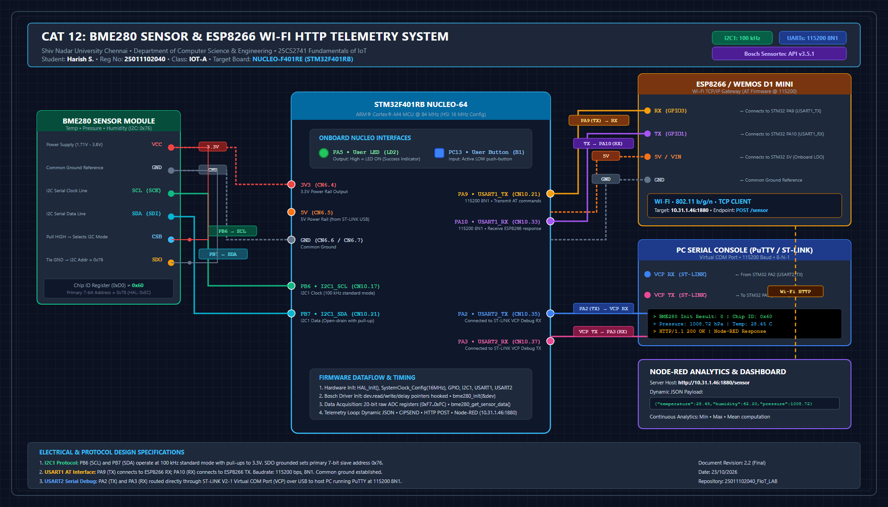

# EXPERIMENT DETAILS

| Field | Description |
|---|---|
| **EXP** | CONTINUOUS LAB EVALUATION-12 |
| **DATE** | 23/10/2026 |
| **NAME OF EXP** | BME280 Sensor Interfacing Using I2C and Bosch Sensor API |
| **HARDWARE SETUP / PLATFORM** | CubeMX + Keil MDK + STM32 Nucleo Development Board (STM32F401RB) + BME280 |
| **TASK NO** | TASK 12A - BME280 Sensor Bring-Up & Chip ID Verification |
| **Circuit Diagram** | Embedded below (`circuit.png`) |
| **Core Logic / Pseudocode / Code Base** | Hardware Abstraction Layer Callbacks + `bme280_init()` Chip ID Read |
| **INFERENCE** | Successfully initialized I2C1 communication and verified BME280 Chip ID (0x60) |

---

## 1. Circuit Diagram



### Hardware Connections
- **Microcontroller**: STM32F401RB Nucleo-64
- **BME280 SCL**: Connected to PB6 (I2C1_SCL)
- **BME280 SDA**: Connected to PB7 (I2C1_SDA)
- **BME280 VCC & CSB**: Connected to Nucleo 3.3V rail (CSB high enables I2C interface)
- **BME280 GND & SDO**: Connected to Nucleo GND rail (SDO low sets 7-bit I2C address to 0x76)
- **USART2 Debug**: PA2 (TX) and PA3 (RX) connected to ST-LINK Virtual COM Port at 115200 8N1

---

## 2. Core Logic & Implementation

### Objective
Establish fundamental physical layer and transport layer connectivity with the BME280 environmental sensor using STM32 HAL I2C1 and the official Bosch Sensortec Sensor API.

### Working Principle
1. Configure I2C1 peripheral at 100 kHz standard mode with 7-bit addressing.
2. Implement required Bosch driver hardware abstraction callbacks: `user_i2c_read`, `user_i2c_write`, and `user_delay_us`.
3. Hook callback pointers into `struct bme280_dev dev`.
4. Call `bme280_init(&dev)` which performs a soft reset, waits 2 ms, and reads register `0xD0` (`BME280_CHIP_ID_ADDR`).
5. Validate that `dev.chip_id == 0x60`.

### Key Code Snippet
```c
/* Set up the API configuration function pointers */
dev.intf_ptr = &dev_addr;
dev.intf = BME280_I2C_INTF;
dev.read = user_i2c_read;
dev.write = user_i2c_write;
dev.delay_us = user_delay_us;

/* Initialize the BME280 sensor (extracts calibration data and checks chip ID) */
rslt = bme280_init(&dev);

snprintf(msg, sizeof(msg), "BME280 Init Result: %d | Chip ID: 0x%02X\r\n", rslt, dev.chip_id);
HAL_UART_Transmit(&huart2, (uint8_t *)msg, strlen(msg), 1000U);
```

---

## 3. Inference

The STM32 successfully established I2C communication with the BME280 sensor breakout board at slave address `0x76`. The returned chip ID `0x60` matches the Bosch Sensortec BME280 silicon signature. Successful initialization lights up onboard LED LD2 (PA5).
