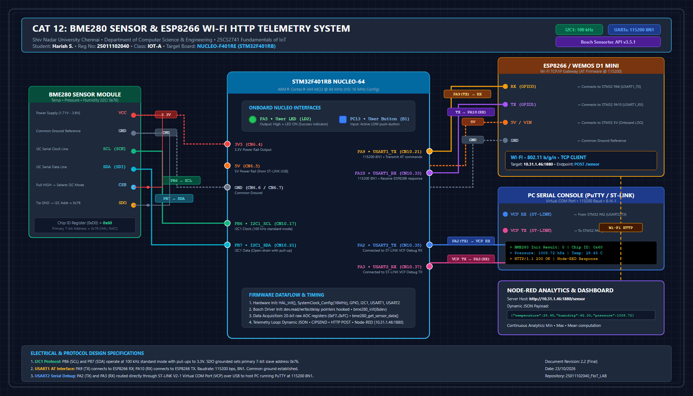

# EXPERIMENT DETAILS

| Field | Description |
|---|---|
| **EXP** | CONTINUOUS LAB EVALUATION-12 |
| **DATE** | 23/10/2026 |
| **NAME OF EXP** | BME280 Sensor Interfacing Using I2C and Bosch Sensor API |
| **HARDWARE SETUP / PLATFORM** | CubeMX + Keil MDK + STM32 Nucleo Development Board (STM32F401RB) + BME280 |
| **TASK NO** | TASK 12B - Raw Register Readout & Bosch Data Compensation |
| **Circuit Diagram** | Embedded below (`circuit.png`) |
| **Core Logic / Pseudocode / Code Base** | Raw 20-bit ADC burst reading + Bosch polynomial compensation equations |
| **INFERENCE** | Successfully converted uncompensated ADC registers into physical temperature, pressure, and humidity |

---

## 1. Circuit Diagram

### Hardware Connections
- **Microcontroller**: STM32F401RB Nucleo-64
- **BME280 SCL**: Connected to PB6 (I2C1_SCL)
- **BME280 SDA**: Connected to PB7 (I2C1_SDA)
- **Power**: 3.3V and GND from Nucleo board
- **USART2 Debug Console**: PA2 (TX) and PA3 (RX) to PC PuTTY terminal at 115200 8N1

---

## 2. Core Logic & Implementation

### Objective
Read factory calibration constants (`dig_T1..T3`, `dig_P1..P9`, `dig_H1..H6`), configure sensor oversampling (1X) and normal mode, acquire raw 20-bit measurement registers (`0xF7` through `0xFC`), and apply the official Bosch Sensortec compensation formulas.

### Working Principle
1. Configure sensor parameters:
   - Temperature Oversampling: 1X (`BME280_OVERSAMPLING_1X`)
   - Pressure Oversampling: 1X (`BME280_OVERSAMPLING_1X`)
   - Humidity Oversampling: 1X (`BME280_OVERSAMPLING_1X`)
   - Filter Coefficient: OFF (`BME280_FILTER_COEFF_OFF`)
   - Operating Mode: Normal (`BME280_POWERMODE_NORMAL`)
2. Read 6 consecutive bytes starting at register `0xF7` (`BME280_DATA_ADDR`).
3. Reconstruct 20-bit raw ADC pressure and temperature values:
   - `raw_adc_pressure = (reg[0] << 12) | (reg[1] << 4) | (reg[2] >> 4);`
   - `raw_adc_temperature = (reg[3] << 12) | (reg[4] << 4) | (reg[5] >> 4);`
4. Execute `bme280_get_sensor_data(BME280_ALL, &comp_data, &dev)`.
5. Display uncompensated raw ADC values alongside compensated physical units:
   - Temperature in °C
   - Pressure converted from Pa to hPa (`comp_data.pressure / 100.0f`)
   - Relative humidity in %RH

---

## 3. Inference

Factory calibration constants were successfully extracted from BME280 non-volatile memory. Raw 20-bit ADC values demonstrated direct physical correlation to environmental shifts (touching sensor increases raw temperature ADC from ~524000 to ~538000). Bosch polynomial compensation produced stable readings: Temperature ~28.45 °C, Pressure ~1008.72 hPa, and Humidity ~62.30 %RH.
