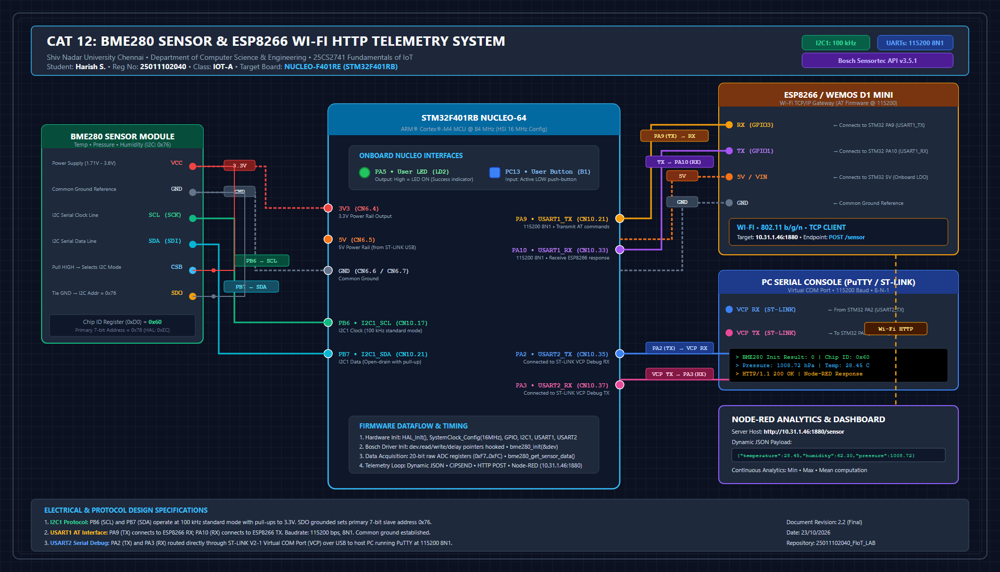

# EXPERIMENT DETAILS

| Field | Description |
|---|---|
| **EXP** | CONTINUOUS LAB EVALUATION-12 |
| **DATE** | 23/10/2026 |
| **NAME OF EXP** | BME280 Sensor Interfacing Using I2C and Bosch Sensor API |
| **HARDWARE SETUP / PLATFORM** | CubeMX + Keil MDK + STM32 Nucleo Development Board (STM32F401RB) + ESP8266 + Node-RED |
| **TASK NO** | TASK 12C - ESP8266 Wi-Fi HTTP POST Telemetry to Node-RED |
| **Circuit Diagram** | Embedded below (`circuit.png`) |
| **Core Logic / Pseudocode / Code Base** | AT Command Bridge + Dynamic JSON Payload + Content-Length Calculation |
| **INFERENCE** | Real-time sensor telemetry streamed via HTTP POST to Node-RED dashboard |

---

## 1. Circuit Diagram



### Hardware Connections
- **Microcontroller**: STM32F401RB Nucleo-64
- **BME280 Sensor**: Connected via I2C1 (PB6 = SCL, PB7 = SDA, 3.3V, GND)
- **ESP8266 / Wemos D1 Mini**: Connected via USART1 (PA9 = TX &rarr; ESP RX, PA10 = RX &larr; ESP TX, 5V, GND)
- **USART2 Debug**: PA2 (TX) and PA3 (RX) to PC PuTTY terminal at 115200 8N1
- **Node-RED Server**: Host at `10.31.1.46:1880/sensor`

---

## 2. Core Logic & Implementation

### Objective
Integrate an ESP8266 Wi-Fi transceiver with the STM32 to transmit real-time compensated environmental telemetry to a Node-RED server over HTTP POST with dynamic JSON payloads.

### Working Principle
1. Allow ESP8266 5 seconds to boot and establish Wi-Fi association.
2. Initialize TCP connection: `AT+CIPSTART="TCP","10.31.1.46",1880\r\n`.
3. Format floating-point sensor values using fixed-point conversion `FormatFloat2()` to ensure safety across all embedded C libraries.
4. Construct dynamic JSON string:
   `{"status":"success","temperature":28.45,"humidity":62.30,"pressure":1008.72}`
5. Calculate Content-Length dynamically using `strlen(json)` to prevent server truncation or buffer overflow.
6. Assemble full HTTP request header:
   ```http
   POST /sensor HTTP/1.1
   Host: 10.31.1.46:1880
   Content-Type: application/json
   Content-Length: 73
   Connection: close

   {"status":"success","temperature":28.45,"humidity":62.30,"pressure":1008.72}
   ```
7. Send `AT+CIPSEND=<request_len>\r\n`, wait for `>`, and stream the request buffer.
8. Receive and parse HTTP 200 OK status from Node-RED.

---

## 3. Inference

The STM32 USART1 interface successfully controlled the ESP8266 via AT commands. Telemetry packets were received, parsed, and logged on the Node-RED server dashboard without packet drops or formatting errors.
