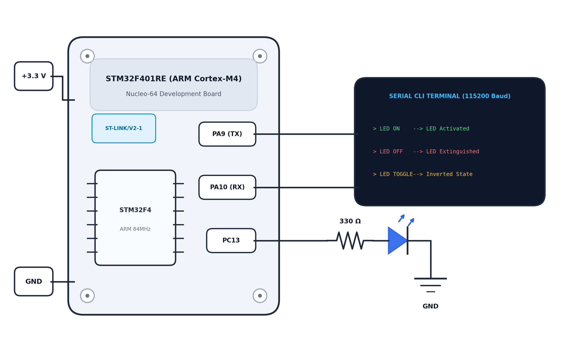

# CAT9 - STM32 Serial Control

## Overview
Continuous Assessment 9 documents the STM32 serial-control tasks. See the task READMEs for the implementation-specific command parser and UART behavior.

## Build steps
1. Open the task-specific CubeMX/Keil project.
2. Build the firmware with the configured toolchain.
3. Connect the ST-Link programmer.
4. Flash the generated image.
5. Reset the board and verify the task-specific serial behavior.

**STUDENT REGISTER NO:** 25011102040

---

## Subtasks

- [TASK9A](TASK9A/README.md) - Interactive serial command parser and LED controller.
- [TASK9B](TASK9B/README.md) - Serial task documentation.

